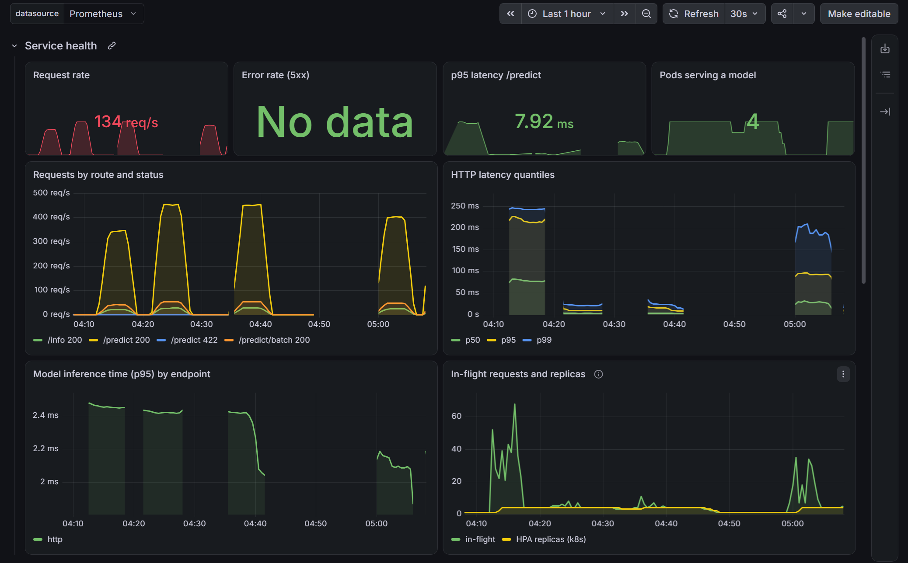
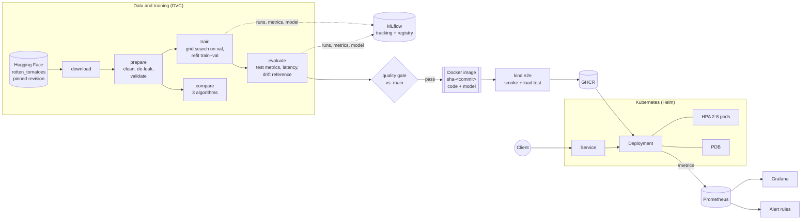
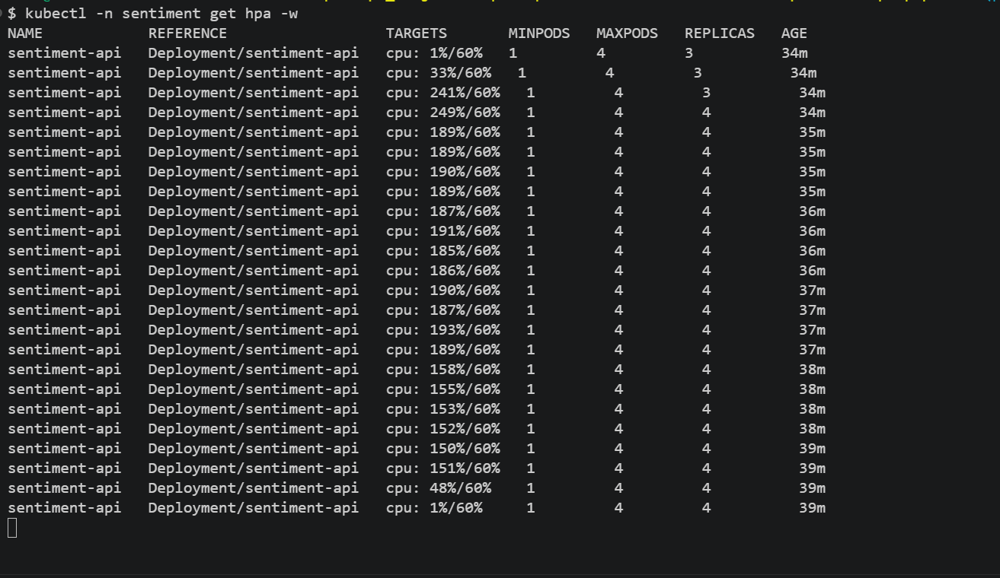
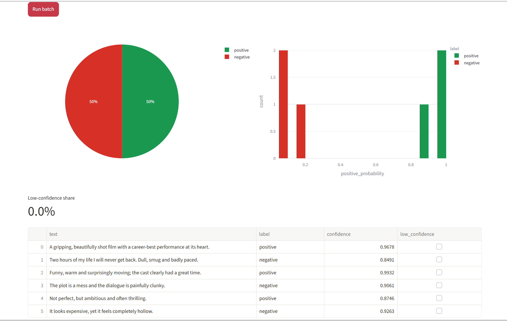
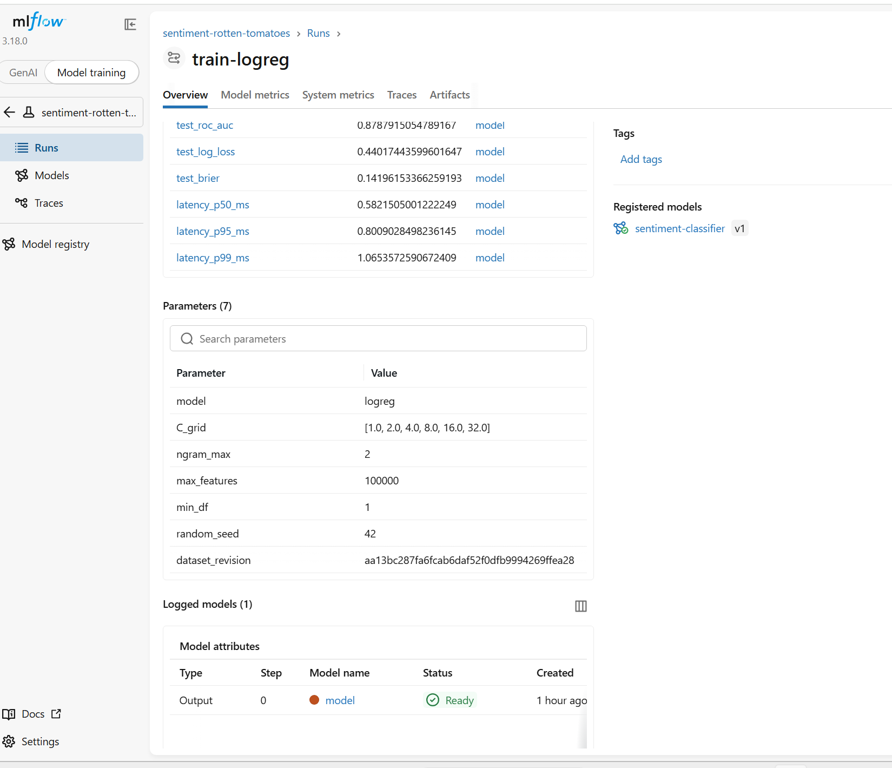

# Sentiment Inference Pipeline: end-to-end MLOps

[](https://github.com/akinpelumiajayi/MLOps-Capstone-Sentiment-Inference-Pipeline/actions/workflows/ci.yml)
[](https://codecov.io/gh/akinpelumiajayi/MLOps-Capstone-Sentiment-Inference-Pipeline)


[](https://github.com/astral-sh/ruff)
[](LICENSE)

A production-style ML system that takes a sentiment classifier from raw data
to a **monitored, autoscaling Kubernetes service**. Training is reproducible,
every model must pass an automated quality gate before it ships, and every
deployment can be rolled back with one command.

The model is intentionally simple (TF-IDF and logistic regression on the
Rotten Tomatoes reviews dataset). The engineering effort went into the system
around it: data versioning, experiment tracking, CI/CD, Kubernetes, monitoring
and drift detection.



## At a glance

| | |
|---|---|
| **Model quality** | Test F1 **0.798**, ROC AUC **0.879** on a held-out set used exactly once |
| **Serving performance** | **527 req/s** with `/predict` p95 **13 ms** on a local kind cluster |
| **Reliability under load** | **178,000+ requests, 0 failures** across the Docker and Kubernetes load tests |
| **Autoscaling** | HPA scales the API out to 4 replicas in under a minute under load |
| **Code quality** | 48 tests, **93.5% coverage**, `mypy --strict`, Ruff, pre-commit hooks |
| **Reproducibility** | `dvc repro` rebuilds data, model and reports from a pinned dataset revision in under a minute |

## Contents

- [What this project demonstrates](#what-this-project-demonstrates)
- [Architecture](#architecture)
- [Screenshots](#screenshots)
- [Results](#results)
- [Quick start](#quick-start)
- [CI/CD](#cicd)
- [Observability](#observability)
- [Design decisions](#design-decisions)
- [Repository layout](#repository-layout)

---

## What this project demonstrates

| Area | What is implemented | Tools |
|---|---|---|
| Data and training | Pinned dataset, cleaning and leak removal between splits, validation checks, hyperparameter search on a validation set, three-model comparison | DVC, scikit-learn, pandas |
| Experiment tracking | Every run logged with parameters and metrics; models registered and promoted with a `champion` alias | MLflow |
| Model governance | Quality gate blocks any model below absolute thresholds **or** worse than the model on `main` | Python, GitHub Actions |
| Serving | REST API with single and batch inference, input limits, readiness and liveness probes, JSON logs, request IDs | FastAPI, Uvicorn, Pydantic |
| Containers | Non-root images (multi-stage build for the API); the model is baked in, so one image tag identifies code and model together | Docker, Docker Compose |
| Kubernetes | Hardened Helm chart: HPA, PodDisruptionBudget, read-only filesystem, zero-downtime rollouts, automatic rollback | Kubernetes, Helm, kind |
| Monitoring | 16-panel dashboard, 8 alert rules each linked to a runbook entry, live drift detection (PSI) | Prometheus, Grafana |
| CI/CD | Lint, types and tests, then train and gate, then a real deploy to a kind cluster with smoke and load tests, then publish to GHCR with SBOM and provenance | GitHub Actions, Jenkins |
| Load testing | Reproducible traffic mix and an in-cluster autoscaling demo | Locust |
| UI | Live prediction, batch analysis and service metrics | Streamlit |

---

## Architecture



**One image tag equals one code version plus one model version.** The model is
baked into the image at build time, so `helm rollback` restores the previous
model as well. There is no separate model store to keep in step.

---

## Screenshots

<table>
  <tr>
    <td width="50%"><b>Horizontal Pod Autoscaler under 150 concurrent users</b><br/></td>
    <td width="50%"><b>Streamlit: batch analysis against the live API</b><br/></td>
  </tr>
  <tr>
    <td colspan="2"><b>MLflow: training run metrics, parameters and the registered <code>sentiment-classifier</code> model</b><br/></td>
  </tr>
</table>

---

## Results

All model numbers are produced by `dvc repro` and committed in
[`reports/`](reports).

### Data
| Split | Rows | Notes |
|---|---|---|
| train | 8,530 | 50/50 class balance |
| validation | 1,066 | used only for hyperparameter selection |
| test | 1,066 | used once, for the final evaluation |

All data-validation checks pass: schema, nulls and empty rows, label domain,
class balance, duplicates, and overlap between splits
([`reports/data_validation.json`](reports/data_validation.json)).

### Model (held-out test set)
| Metric | Value |
|---|---|
| Accuracy | **0.797** |
| F1 | **0.798** |
| Precision / recall | 0.796 / 0.799 |
| ROC AUC | 0.879 |
| Log loss / Brier | 0.440 / 0.142 |
| In-process latency p50 / p95 / p99 | 0.53 / 0.73 / 0.88 ms |
| Model file on disk (compressed) | 1.7 MB |

Classic bag-of-words baselines on this dataset score in the high 70s.
Fine-tuned transformers reach the high 80s at much higher cost (see
[Design decisions](#design-decisions)).

### Algorithm comparison
Each algorithm goes through the same protocol: select on validation, refit on
train+validation, score once on test
([`reports/model_comparison.md`](reports/model_comparison.md)).

| Model | Test F1 | ROC AUC | Log loss | p95 latency | In-memory size |
|---|---|---|---|---|---|
| Complement Naive Bayes | **0.809** | **0.893** | 0.468 | 1.72 ms | 8.1 MB |
| **Logistic regression (shipped)** | 0.798 | 0.879 | **0.440** | **0.81 ms** | **4.9 MB** |
| Linear SVM (calibrated) | 0.796 | 0.876 | 0.441 | 4.18 ms | 6.5 MB |

### Serving under load
Measured on a single laptop with a [Locust traffic mix](loadtest/locustfile.py)
of single predictions, batch predictions and `/info` calls.

| Setup | Load | Requests | Failures | Throughput | `/predict` p50 / p95 / p99 |
|---|---|---|---|---|---|
| Docker Compose, 1 API container (`make loadtest`) | 50 users, 2 min | 20,271 | **0** | 170 req/s | 10 / 26 / 41 ms |
| kind + Helm, HPA at 4 replicas (`make hpa-demo`) | 150 users, 5 min | 158,103 | **0** | 527 req/s | 4 / 13 / 24 ms |

In the kind run, the HPA scaled to its 4-replica maximum once CPU passed the
60% target. All pods share the laptop's CPU with Prometheus and Grafana, so
these are relative numbers, not capacity planning. CI also runs a 30-second
load test against the Helm deployment on kind (artifact `e2e-loadtest`).

---

## Quick start

**Prerequisites:** Python 3.12+ and Docker. For Kubernetes you also need kind,
kubectl and Helm. On Windows, run `make` from Git Bash or WSL.

```bash
make install          # .venv + dev dependencies + pre-commit hooks
make train            # dvc repro: download -> prepare -> train -> evaluate -> compare
make check            # ruff + mypy --strict + pytest (coverage >= 85%)
make serve            # API on http://localhost:8000/docs
```

### Full stack with Docker Compose
```bash
cp .env.example .env  # then set GRAFANA_ADMIN_PASSWORD before the first start
make up               # builds, trains if no model exists, starts everything
make smoke            # end-to-end checks against the running API
make loadtest         # 2-minute load test, results in reports/
```

| Service | URL |
|---|---|
| API (Swagger) | http://localhost:8000/docs |
| Streamlit UI | http://localhost:8501 |
| MLflow | http://localhost:5000 |
| Prometheus (with alert rules) | http://localhost:9090 |
| Grafana (dashboard provisioned) | http://localhost:3000 |

### Kubernetes (kind)
```bash
WITH_MONITORING=1 make kind-up    # cluster + metrics-server + kube-prometheus-stack
make kind-deploy                  # build image -> kind load -> helm install -> smoke test
make hpa-demo                     # in-cluster load; logs replica count to reports/hpa-demo.log
make kind-down
```

### API
| Endpoint | Method | Description |
|---|---|---|
| `/predict` | POST | `{"text": "..."}` returns `label`, `confidence`, `positive_probability`, `low_confidence`, `model_version` |
| `/predict/batch` | POST | `{"texts": [...]}`, up to `MAX_BATCH_SIZE` (100) |
| `/info` | GET | Model version and type, training date, thresholds, limits |
| `/healthz` | GET | Liveness: the process is up |
| `/readyz` | GET | Readiness: a model is loaded (503 otherwise) |
| `/metrics` | GET | Prometheus metrics (not exposed through the Ingress) |

```bash
curl -s localhost:8000/predict -H 'content-type: application/json' \
  -d '{"text": "A gripping, beautifully shot film."}'
```

`confidence` is always the probability of the **returned** label (0.5 to 1.0).
Configuration comes from environment variables; see
[`settings.py`](src/sentiment/api/settings.py).

---

## CI/CD

[`.github/workflows/ci.yml`](.github/workflows/ci.yml) runs these jobs:

| Job | Runs on | What it does |
|---|---|---|
| `quality` | every push/PR | ruff, ruff format, mypy --strict, pytest with coverage, Codecov |
| `helm` | every push/PR | `helm lint --strict`, render with and without CRDs, `kubeconform -strict`, and checks that `latest` and missing tags are rejected |
| `train` | every push/PR | `dvc repro`, metrics diff in the job summary, **quality gate** against `main`, MLflow `champion` promotion |
| `e2e` | every push/PR | builds the image, deploys it with Helm to a **kind** cluster, then runs the smoke test and a 30 s load test through the Service |
| `publish` | `main` | pushes `ghcr.io/<repo>/sentiment-api:sha-<commit>` with SBOM and provenance attestations |
| `deploy` | `main`, opt-in | `helm upgrade --rollback-on-failure` to your cluster, then a post-deploy smoke test |

The quality gate ([`gate.py`](src/sentiment/gate.py), thresholds in
[`params.yaml`](params.yaml)) requires all of the following:

- F1 ≥ 0.75
- Accuracy ≥ 0.75
- p95 latency ≤ 25 ms
- F1 no more than 0.01 below the model on `main`

**Optional configuration** (repo Settings → Secrets and variables):

| Name | Type | Purpose |
|---|---|---|
| `DVC_REMOTE_URL` | variable | e.g. `s3://bucket/dvc`. Enables `dvc pull`/`push` |
| `AWS_ROLE_ARN`, `AWS_REGION` | variables | IAM role assumed via **GitHub OIDC**, so no long-lived AWS keys are stored |
| `DEPLOY_ENABLED` | variable | `true` turns on the `deploy` job |
| `KUBECONFIG` | secret | base64-encoded kubeconfig for the target cluster |

Add required reviewers to the `production` environment for a manual approval
step. A [Jenkinsfile](jenkins/Jenkinsfile) with the same stages is provided
for teams that use Jenkins.

---

## Observability

The Grafana dashboard is provisioned from
[`monitoring/grafana/dashboards/sentiment-api.json`](monitoring/grafana/dashboards/sentiment-api.json)
and works in both Docker Compose and Kubernetes. It shows:

- **Service:** request rate, 5xx ratio, latency quantiles, inference time, in-flight requests, HPA replicas
- **Model:** predictions by label, confidence quantiles, low-confidence share, input length, out-of-vocabulary rate
- **Drift:** PSI of the live score distribution and of input length against the test-set reference, and live vs. reference positive rate

**How drift detection works.** At evaluation time the pipeline stores a
[reference profile](src/sentiment/drift.py) next to the model. Each API pod
keeps a rolling window of its last 500 predictions and computes the
Population Stability Index (PSI) against that reference. The same check can
run offline: `make drift INPUT=batch.csv`.

**Alerts** are defined once in [`helm/sentiment-api/files/alerts.yml`](helm/sentiment-api/files/alerts.yml),
which feeds both Docker Compose and the Helm `PrometheusRule`. They cover:

- availability: API down, model not loaded, 5xx above 2%
- latency: p95 above 100 ms
- model quality: score drift, positive-rate shift, high OOV rate, low-confidence spike

Each alert links to a section of the [runbook](docs/runbook.md).

---

## Design decisions

**Why ship logistic regression when Naive Bayes scores 1.1 points higher on F1?**
The API returns probabilities, and drift monitoring watches the probability
distribution, so calibration matters as much as accuracy. Logistic regression
is the best calibrated of the three (lowest log loss and Brier score), about
2× faster at p95 than Naive Bayes, and the smallest artifact. Swapping models
is a one-line change (`train.model` in `params.yaml`), and the gate and
comparison report would show the effect in the PR.

**Why not a transformer?** A fine-tuned DistilBERT would probably gain 8 to 10
points of accuracy, at roughly 100× the CPU latency, a much larger image and
far slower retraining. For a project about the pipeline, a sub-millisecond
model keeps CI fast (the full pipeline runs in under a minute) and makes the
autoscaling behaviour easy to demonstrate. The `build_pipeline` interface is
where a transformer would plug in.

**Why bake the model into the image?** It makes deployments immutable and
rollbacks atomic: `sha-<commit>` identifies code, model and dependencies
together. The trade-off is that a retrain needs a new image, which takes
seconds at this model size. For large models I would pull from the MLflow
registry by alias in an init container instead.

**Why DVC and MLflow together?** They answer different questions. DVC answers
"can I reproduce this exact artifact?": it tracks data and pipeline lineage
and skips stages whose inputs have not changed. MLflow answers "how did this
run compare with the others?": it holds experiment history, the registry and
the `champion` alias.

**Why are the drift metrics per pod?** It keeps the API stateless. Prometheus
aggregates across pods (`max`/`avg` in the alert rules), and the window size
is configurable. For exact fleet-wide drift you would log predictions to a
store and run `sentiment.drift` as a scheduled job.

**Why does the HPA scale on CPU?** Inference is CPU-bound with one worker per
pod, so CPU tracks load closely. Scaling on requests per second would need the
Prometheus adapter, which is a reasonable next step.

**Limitations and next steps**
- A canary or shadow rollout (Argo Rollouts) would gate on live metrics, not only offline ones.
- Prediction logging to object storage would enable delayed-label evaluation and retraining triggers.
- The training data is film reviews, so other domains will show high OOV rates and drift. The alerts are designed to catch exactly that.

---

## Repository layout

```
├── src/sentiment/
│   ├── data.py, validation.py      # download, clean, de-leak, validate
│   ├── model.py                    # candidate pipelines (logreg / SVM / NB)
│   ├── train.py, evaluate.py       # DVC stages
│   ├── compare.py, gate.py         # model comparison, quality gate
│   ├── drift.py, tracking.py       # PSI drift detection, MLflow wrapper
│   ├── pipeline.py                 # same pipeline without DVC (used by the trainer container)
│   └── api/                        # FastAPI app, settings, schemas, metrics, logging
├── tests/                          # 48 tests: API, data, training, gate, drift, MLflow
├── helm/sentiment-api/             # chart + values-kind.yaml + files/alerts.yml
├── monitoring/                     # Prometheus config, Grafana provisioning + dashboard
├── loadtest/locustfile.py
├── scripts/                        # smoke test, kind up/deploy, HPA demo
├── streamlit_app/                  # UI: live, batch, metrics
├── reports/                        # committed metrics, comparison, data validation
├── docs/                           # runbook, screenshots
├── dvc.yaml, dvc.lock, params.yaml
├── Dockerfile, Dockerfile.train, docker-compose.yml
├── .github/workflows/ci.yml, jenkins/Jenkinsfile
└── pyproject.toml, requirements*.txt, Makefile
```

---

## Data and licence

The [Rotten Tomatoes dataset](https://huggingface.co/datasets/cornell-movie-review-data/rotten_tomatoes)
comes from Pang and Lee (2005), *Seeing stars: Exploiting class relationships
for sentiment categorization with respect to rating scales*. The code is
released under the [MIT licence](LICENSE).

*Originally built as the AI R&D capstone at Sheffield Hallam University.*
